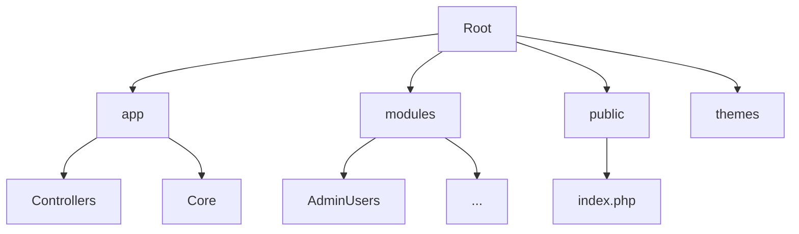

# 🛡️ CSHC - CoreSecure Hybrid Connect

> **Solution VPN Cloud, VPLS, et FTTx haute disponibilité.**
> Une plateforme moderne et modulaire pour la gestion de services réseau hybrides.

  

Bienvenue dans le dépôt du projet **CSHC**. Ce projet est une application web PHP personnalisée utilisant une architecture **MVC** (Modèle-Vue-Contrôleur) complète et un système de **modules** extensible. Il permet la gestion des clients, des services (VPN, Fibre, etc.) et offre une interface d'administration complète.

---

## 🚀 Fonctionnalités Clés

*   **⚡ Architecture MVC Robuste** : Structure claire séparant la logique métier (Contrôleurs), les données et l'affichage (Vues), avec **Autoloading** des classes.
*   **🔌 Système Modulaire Avancé** : Extension facile des fonctionnalités via le dossier `modules/` avec support de Controllers et Views indépendants.
*   **🎨 Moteur de Thèmes** : Interface personnalisable via le dossier `themes/` (Front-end & Admin) avec auto-découverte des vues modulaires.
*   **🛠️ Mode Debug & Maintenance** :
    *   Fichier `.env` pour la configuration de l'environnement (`APP_DEBUG`, `MAINTENANCE_MODE`).
    *   Pages d'erreur détaillées en mode debug, stylisées en production.
    *   Page de maintenance bloquante (sauf pour les admins).
*   **🛠️ Panneau d'Administration** :
    *   Gestion des Utilisateurs & Permissions.
    *   Gestion des Services (Activation, Suspension, Édition).
    *   **Configuration Globale** : Modifiez le nom du site et l'URL directement depuis l'admin.
    *   Gestionnaire de Modules (Activation/Désactivation).

---

## 📂 Structure du Projet



| Dossier | Description |
| :--- | :--- |
| **`app/`** | Cœur de l'application. Contient la logique métier. |
| &nbsp;&nbsp;`Controllers/` | Contrôleurs principaux de l'application. |
| &nbsp;&nbsp;`Core/` | Classes système (Database, Router, View, Settings, Hook, Env, ErrorHandler, ModuleManager). |
| **`modules/`** | Extensions fonctionnelles. Chaque module peut avoir ses propres `Controllers/` et `Views/`. |
| **`public/`** | Racine web (`DocumentRoot`). Contient `index.php` et les assets. |
| **`themes/`** | Gabarits d'affichage (`default` pour le site, `admin_default` pour le back-office, `errors/` pour les pages d'erreur). |
| **`.env`** | Configuration de l'environnement (base de données, debug, maintenance). |

---

## 🛠️ Installation

### Pré-requis
*   PHP 7.4 ou supérieur (8.0+ recommandé).
*   MySQL / MariaDB.
*   Extension PDO MySQL activée.
*   Serveur Web (Apache/Nginx) avec réécriture d'URL activée.

### Guide de démarrage rapide

1.  **Cloner le dépôt** :
    ```bash
    git clone https://github.com/bastivanconsulting/CSHC_WEB.git
    ```

2.  **Configurer l'environnement** :
    Copiez le fichier `.env.example` (s'il existe) ou créez un fichier `.env` à la racine :
    ```ini
    APP_NAME=CSHC
    APP_ENV=local
    APP_DEBUG=true
    MAINTENANCE_MODE=false
    ```

3.  **Configurer le serveur web** :
    Pointez le `DocumentRoot` de votre serveur sur le dossier `public/`.

4.  **Base de Données** :
    L'application tentera de créer ses tables automatiquement via le fichier `update_db.php` ou lors du premier accès (si configuré). Assurez-vous que la connexion BDD dans `app/Core/Database.php` est correcte (pour l'instant, credentials hardcodés ou à déplacer dans .env).

5.  **Connexion Administrateur** :
    *   Utilisateur par défaut créé lors de l'installation ou via injection SQL.
    
---

## ⚙️ Configuration

### Mode Debug et Maintenance
Dans le fichier `.env` à la racine :

*   `APP_DEBUG=true` : Affiche les erreurs détaillées avec stack trace. Utile pour le développement.
*   `APP_DEBUG=false` : Affiche une page d'erreur générique "500" ou "404" stylisée.
*   `MAINTENANCE_MODE=true` : Active la page de maintenance pour tous les visiteurs (sauf les administrateurs connectés).

### Configuration du Site
Les paramètres (URL du site, Nom du site) sont gérés en base de données :

1.  Connectez-vous à l'administration (`/admin`).
2.  Allez dans **Paramètres** (`/admin/settings`).

---

## 💻 Développement de Modules

CSHC utilise une architecture modulaire avancée.

### Créer un Module MVC
Créez un dossier dans `modules/MonModule` :
```
modules/MonModule/
├── Controllers/
│   └── MonController.php
├── Views/
│   └── ma_vue.php
└── index.php
```

**1. Le Contrôleur (`modules/MonModule/Controllers/MonController.php`)**
```php
namespace Modules\MonModule\Controllers;
use View;

class MonController {
    public function index() {
        // Charge automatiquement modules/MonModule/Views/ma_vue.php
        View::render('ma_vue', ['nom' => 'CSHC']);
    }
}
```

**2. Le Point d'Entrée (`modules/MonModule/index.php`)**
```php
use Modules\MonModule\Controllers\MonController;

Hook::listen('register_routes', function($routes) {
    $routes['mon-url'] = [
        'controller' => MonController::class,
        'method' => 'index'
    ];
    return $routes;
});
```

---

## 🤝 Contribution

Les contributions sont les bienvenues ! Veuillez suivre les standards de code PSR-12 et utiliser le système de modules pour les nouvelles fonctionnalités.

---

<div align="center">
    <small>&copy; 2025 Bastivan Consulting. Tous droits réservés.</small>
</div>
