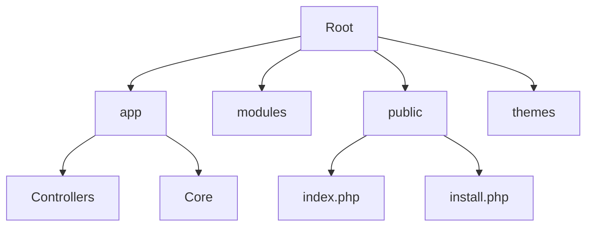

# 🛡️ CSHC - CoreSecure Hybrid Connect

> **Solution VPN Cloud, VPLS, et FTTx haute disponibilité.**
> Une plateforme moderne et modulaire pour la gestion de services réseau hybrides.

  

Bienvenue dans le dépôt du projet **CSHC**. Ce projet est une application web PHP personnalisée utilisant une architecture **MVC** (Modèle-Vue-Contrôleur) légère et un système de **modules** extensible. Il permet la gestion des clients, des services (VPN, Fibre, etc.) et offre une interface d'administration complète.

---

## 🚀 Fonctionnalités Clés

*   **⚡ Architecture MVC Légère** : Structure claire séparant la logique métier, les données et l'affichage.
*   **🔌 Système Modulaire** : Extension facile des fonctionnalités via le dossier `modules/` sans toucher au cœur.
*   **🎨 Moteur de Thèmes** : Interface personnalisable via le dossier `themes/` (Front-end & Admin).
*   **🛠️ Panneau d'Administration** :
    *   Gestion des Utilisateurs & Permissions.
    *   Gestion des Services (Activation, Suspension, Édition).
    *   **Configuration Globale** : Modifiez le nom du site et l'URL directement depuis l'admin.
    *   Gestionnaire de Modules (Activation/Désactivation).
*   **📦 Installateur Automatique** : Script `install.php` pour un déploiement rapide.

---

## 📂 Structure du Projet



| Dossier | Description |
| :--- | :--- |
| **`app/`** | Cœur de l'application. Contient la logique métier. |
| &nbsp;&nbsp;`Controllers/` | Contrôleurs qui gèrent les requêtes (Admin, Auth, Home, etc.). |
| &nbsp;&nbsp;`Core/` | Classes système (Database, Router, View, Settings, Hook). |
| **`modules/`** | Extensions fonctionnelles (ex: Notifications, API tierces). |
| **`public/`** | Racine web (`DocumentRoot`). Contient `index.php` et les assets (CSS/JS). |
| **`themes/`** | Gabarits d'affichage (`default` pour le site, `admin_default` pour le back-office). |

---

## 🛠️ Installation

### Pré-requis
*   PHP 7.4 ou supérieur (8.0+ recommandé).
*   MySQL / MariaDB.
*   Extension PDO MySQL activée.
*   Serveur Web (Apache/Nginx) avec réécriture d'URL activée.

### Guide de démarrage rapide

1.  **Cloner le dépôt** :
    ```bash
    git clone https://github.com/votre-repo/cshc.git
    ```

2.  **Configurer le serveur web** :
    Pointez le `DocumentRoot` de votre serveur sur le dossier `public/`.

3.  **Lancer l'installation** :
    Accédez à votre site via votre navigateur (ex: `http://localhost/install.php` ou juste `/` si `install.php` est détecté).
    *   Remplissez les informations de base de données.
    *   Le script créera les tables `users`, `services`, `settings` et le fichier `app/config.php`.

4.  **Connexion Administrateur** :
    *   **Email** : `admin@cshc.local`
    *   **Mot de passe** : `admin123`
    
    > ⚠️ **Important** : Changez ce mot de passe immédiatement après la première connexion !

---

## ⚙️ Configuration

Les paramètres principaux (URL du site, Nom du site) sont gérés en base de données pour plus de flexibilité.

1.  Connectez-vous à l'administration (`/admin`).
2.  Allez dans **Paramètres** (`/admin/settings`).
3.  Modifiez les valeurs selon vos besoins.

---

## 💻 Développement

### Créer un Module
Créez un dossier dans `modules/MonModule` avec un fichier `index.php`.
```php
<?php
// modules/MonModule/index.php

// S'accrocher à un Hook
Hook::add('navbar_items', function() {
    echo '<li class="nav-item"><a class="nav-link" href="/mon-module">Mon Module</a></li>';
});

// Définir une route
Hook::add('register_routes', function() {
    return [
        'mon-module' => function() {
            echo "Hello from MonModule!";
        }
    ];
});
```
Ensuite, activez-le depuis l'administration.

---

## 🤝 Contribution

Les contributions sont les bienvenues ! Veuillez suivre les standards de code PSR-12.

---

<div align="center">
    <small>&copy; 2025 Bastivan Consulting. Tous droits réservés.</small>
</div>
