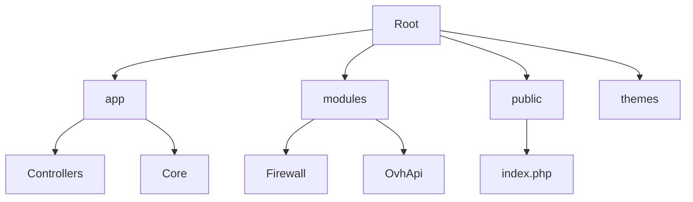

# 🛡️ CSHC - CoreSecure Hybrid Connect

> **Solution VPN Cloud, VPLS, et FTTx haute disponibilité avec Protection WAF intégrée.**
> Une plateforme moderne et modulaire pour la gestion de services réseau hybrides et la sécurité web.

  

Bienvenue dans le dépôt du projet **CSHC**. Ce projet est une application web PHP personnalisée utilisant une architecture **MVC** (Modèle-Vue-Contrôleur) complète et un système de **modules** extensible. Il permet la gestion des clients, des services (VPN, Fibre, etc.) et inclut un **Firewall applicatif (WAF)** de nouvelle génération.

---

## 🚀 Fonctionnalités Clés

*   **⚡ Architecture MVC Robuste** : Structure claire séparant la logique métier (Contrôleurs), les données et l'affichage (Vues), avec **Autoloading** des classes.
*   **🔌 Système Modulaire Avancé** : Extension facile des fonctionnalités via le dossier `modules/` avec support de Controllers et Views indépendants.
*   **🛡️ Module Firewall & WAF (CoreSecure)** :
    *   **Protection WAF** : Analyse du trafic avec des règles inspirées de Comodo/OWASP (SQLi, XSS, RCE, LFI, User-Agents malveillants).
    *   **Challenge Anti-Bot Avancé** : Page d'interception avec animation de sécurité (> 5s), affichage IP/RayID, et vérification JavaScript obligatoire ("Fail-closed").
    *   **Détection Proxy & Captcha** : Détection automatique des IPs suspectes (Proxy/VPN/Tor) déclenchant un **Math Captcha** avant l'accès.
    *   **Rate Limiting** : Protection contre les abus et DDoS applicatifs par limitation de débit par IP/Domaine.
    *   **Vérification DNS** : Validation de la propriété des domaines via enregistrements TXT auto-générés.
*   **🔒 Sécurité Renforcée** :
    *   **CSRF Protection** : Système complet de jetons anti-CSRF sur tous les formulaires.
    *   **Strict Headers** : HSTS, CSP, X-Frame-Options configurés par défaut.
    *   **Session Hardening** : Cookies sécurisés (Secure, HttpOnly, SameSite=Strict).
*   **🎨 Moteur de Thèmes** : Interface personnalisable (Glassmorphism) via le dossier `themes/` (Front-end & Admin).
*   **🛠️ Panneau d'Administration** :
    *   Gestion des Utilisateurs, Services, et Modules.
    *   Logs WAF détaillés et bannissement manuel d'IP.

---

## 📂 Structure du Projet



| Dossier | Description |
| :--- | :--- |
| **`app/`** | Cœur de l'application. Contient la logique métier. |
| &nbsp;&nbsp;`Controllers/` | Contrôleurs principaux (`AdminController`, `ClientFirewallController`, etc.). |
| &nbsp;&nbsp;`Core/` | Classes système (Database, Router, View, Settings, Hook, Csrf, ErrorHandler). |
| **`modules/`** | Extensions fonctionnelles (ex: `Firewall/index.php` pour le WAF). |
| **`public/`** | Racine web (`DocumentRoot`). Contient `index.php` et les assets. |
| **`themes/`** | Gabarits d'affichage (`default` pour le site, `admin_default` pour le back-office). |
| **`.env`** | Configuration de l'environnement (base de données, debug, maintenance). |

---

## 🛠️ Installation

### Pré-requis
*   PHP 7.4 ou supérieur (8.0+ recommandé).
*   MySQL / MariaDB.
*   Extension PDO MySQL et cURL activées.
*   Serveur Web (Apache/Nginx) avec réécriture d'URL activée.

### Guide de démarrage rapide

1.  **Cloner le dépôt** :
    ```bash
    git clone https://github.com/bastivanconsulting/CSHC_WEB.git
    ```

2.  **Configurer l'environnement** :
    Copiez le fichier `.env.example` (s'il existe) ou créez un fichier `.env` à la racine :
    ```ini
    APP_NAME=CSHC
    APP_ENV=local
    APP_DEBUG=true
    MAINTENANCE_MODE=false
    ```

3.  **Configurer le serveur web** :
    Pointez le `DocumentRoot` de votre serveur sur le dossier `public/`.

4.  **Base de Données** :
    L'application gère ses migrations via le code (auto-migration dans les modules). Assurez-vous que la connexion BDD dans `app/Core/Database.php` est correcte.

5.  **Protection WAF** :
    Pour activer la protection sur un site externe, ajoutez le script généré depuis le tableau de bord client (`/client/firewall`) dans le `<head>` de votre site.

---

## ⚙️ Configuration

### Mode Debug et Maintenance
Dans le fichier `.env` à la racine :

*   `APP_DEBUG=true` : Affiche les erreurs détaillées.
*   `MAINTENANCE_MODE=true` : Active la page de maintenance (bypass admin disponible).

### Module Firewall
Les paramètres du Firewall (Seuils, Mode Challenge/Monitor) sont configurables via l'interface client ou admin. Le script JS de protection est servi dynamiquement via `?firewall_js=true`.

---

## 🤝 Contribution

Les contributions sont les bienvenues ! Veuillez suivre les standards de code PSR-12.

---

<div align="center">
    <small>&copy; 2025 Bastivan Consulting. Tous droits réservés.</small>
</div>
